  

Salut, moi c'est Thomas. Je suis en 4e année à l'Icam Toulouse, et l'essentiel de ce que je fais tient en une boucle : je dessine sur SolidWorks, je fabrique, je regarde ce qui coince, je recommence.

Ça a donné une petite marque de lampes imprimées en 3D, une app de muscu que j'utilise tous les jours, et l'interface d'un robot pour les pompiers de l'Aude.

  
  

  
  

  

<picture>
  <source media="(prefers-color-scheme: dark)" srcset="https://raw.githubusercontent.com/ROKIStudioLampeDesign/ROKIStudioLampeDesign/output/snake-dark.svg" />
  <source media="(prefers-color-scheme: light)" srcset="https://raw.githubusercontent.com/ROKIStudioLampeDesign/ROKIStudioLampeDesign/output/snake-light.svg" />
  
</picture>

[LinkedIn](https://www.linkedin.com/in/thomas-rocchi/) · [roki-studio.fr](https://roki-studio.fr)
